

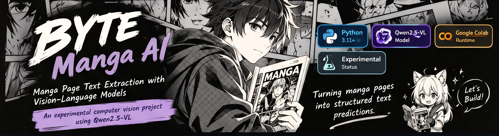

 

---
# BYTE Applied ML — Manga Task

*Turning manga page images into structured text predictions.*

## Project Overview

This repository contains my notebook and experiment notes for the BYTE Applied ML Manga Task. The goal is to process manga page images and produce structured text predictions in JSONL format.

## Model

- Model: Qwen/Qwen2.5-VL-3B-Instruct
- Inference environment: Google Colab
- GPU used: NVIDIA Tesla T4
- Model loading: 4-bit quantization
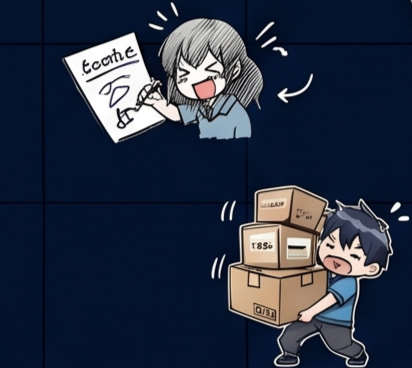
&nbsp;

- `manga_inference_clean.ipynb` — notebook for running inference and generating predictions.
- `experiments.md` — notes and preliminary results from prompt experiments.
- `requirements.txt` — Python package dependencies. 

&nbsp;

1. Open `manga_inference_clean.ipynb` in Google Colab.
2. Make sure the task dataset is available at the path expected by the notebook.
3. Enable a GPU runtime in Colab.
4. Run the notebook cells in order.
5. The notebook generates JSONL predictions for the test sequences and checks the output structure.

The dataset should contain the development and test folders, along with the task's provided supporting files.

&nbsp;

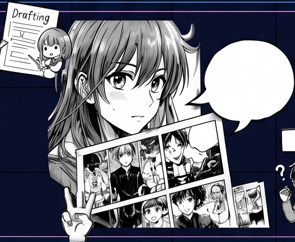

Preliminary prompt and output-format experiments are documented in `experiments.md`. These experiments used only three pilot sequences, so the results are limited and should not be treated as a reliable estimate of overall performance.

 

- The pilot experiments were conducted on a small sample.
- The final test predictions use `UNKNOWN` for speaker labels.
- Valid output structure does not guarantee high prediction accuracy.
- The notebook performs inference; it does not represent a newly trained model or newly trained model weights.

 

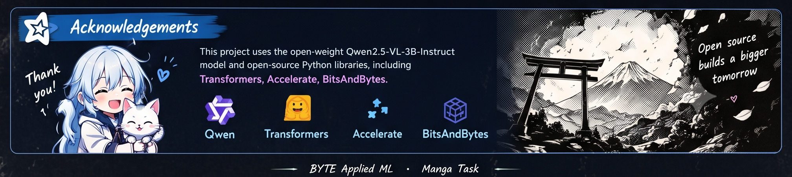
 
 

This screenshot shows the dataset path being detected and CUDA availability checked.

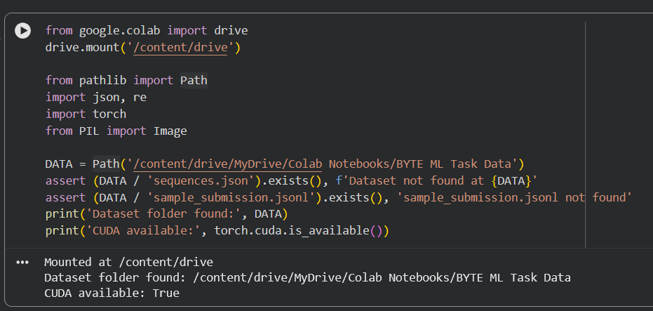

The notebook installs the Python packages needed for inference.

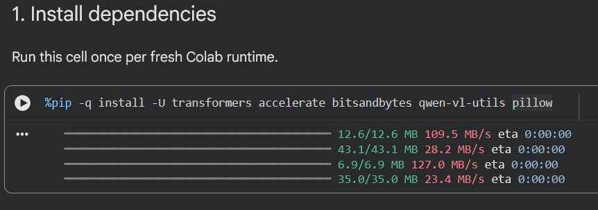

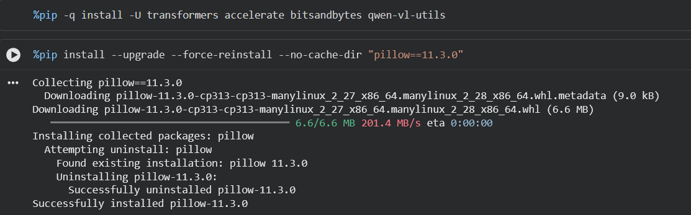

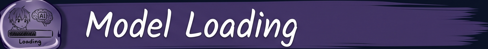

Qwen2.5-VL-3B-Instruct loaded successfully in the Colab Tesla T4 environment.

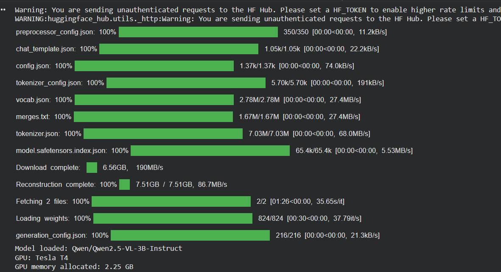

The notebook processes the three pages of each test sequence and saves
the generated predictions in JSONL format.

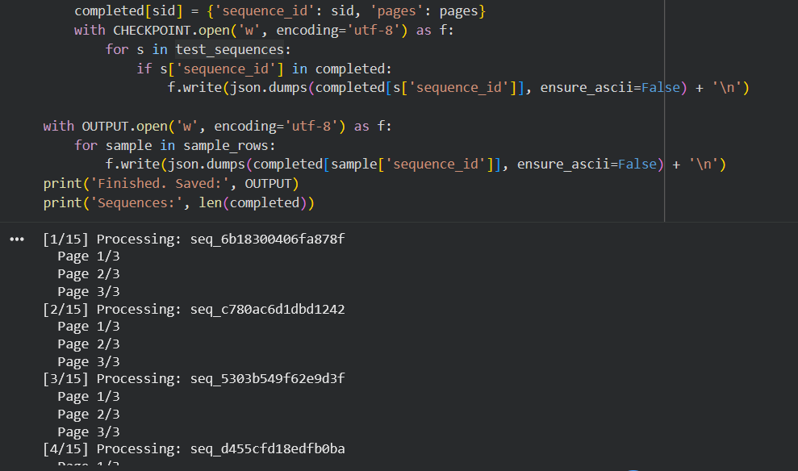

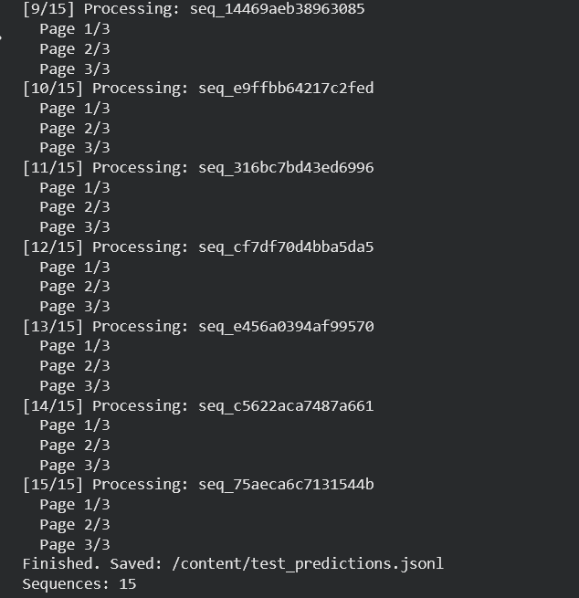

The inference notebook processed all 15 test sequences, with three pages
per sequence. The output JSONL structure was checked before downloading
the predictions file.

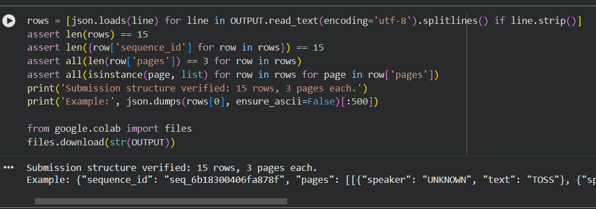
 

 

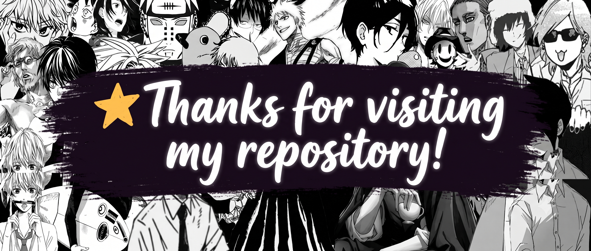

